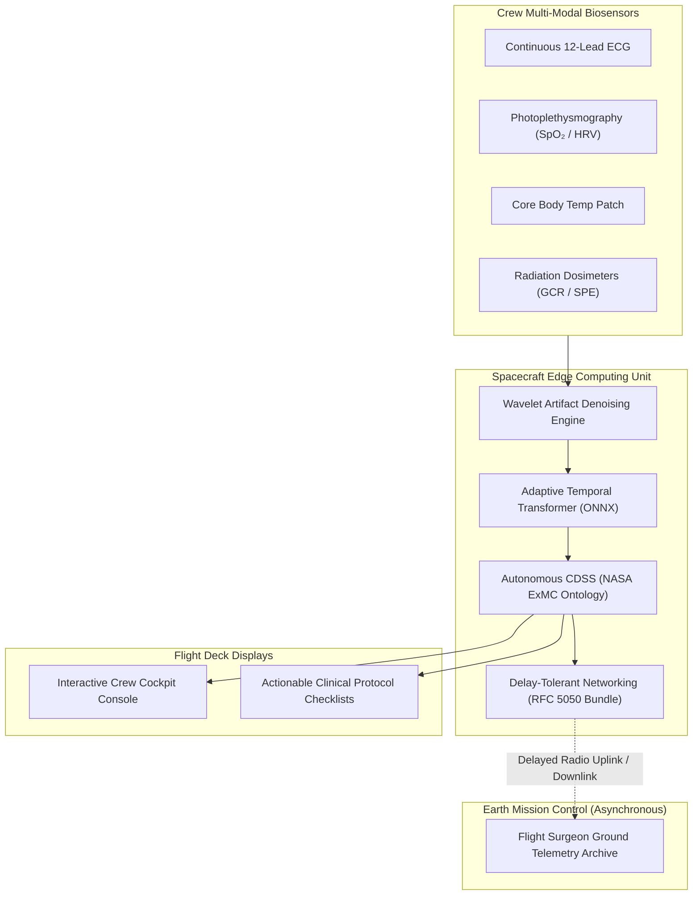

# BioOrbit-Edge 🚀
### Autonomous Edge-AI Health Monitoring & Predictive Clinical Decision Support System (CDSS) for Long-Duration Spaceflight

[](https://www.spaceappschallenge.org)
[](LICENSE)
[](https://github.com)
[](https://github.com)

---

## 🌟 Executive Summary

**BioOrbit-Edge** is an autonomous, zero-cloud medical intelligence and real-time biotelemetry platform engineered specifically for astronauts on deep space exploration missions (e.g., Artemis lunar habitats and crewed Mars transits). 

By integrating multi-modal wearable biosensors directly with spacecraft edge hardware, BioOrbit-Edge tracks physiological dynamics, filters high-intensity motion artifacts, and uses predictive machine learning to detect acute anomalies days before symptoms manifest. Operating with 100% edge autonomy, its offline Clinical Decision Support System (CDSS) acts as a virtual flight surgeon during the multi-minute communication blackouts inherent to interplanetary transit.

---

## 🧭 Core Challenge Alignment

| Deep Space Challenge | Operational Barrier | BioOrbit-Edge Solution |
| :--- | :--- | :--- |
| **Communication Latency** | Mars communications face a **4 to 24-minute one-way delay** and multi-week solar conjunction blackouts. Real-time Earth telemedicine is impossible. | **100% Offline Edge Computing:** All neural inference, baseline tracking, and diagnostic trees run locally on rad-hardened edge nodes in `< 20ms`. |
| **Hostile Microgravity Physiology** | Cephalad fluid shifts, cardiovascular deconditioning, bone mineral loss, and Spaceflight-Associated Neuro-ocular Syndrome (SANS) skew standard medical baselines. | **Dynamic Individual Baselines:** Adaptive machine learning separates natural microgravity adaptation from acute pathology. |
| **Sensor Noise & Motion Artifacts** | Mandatory 2.5-hour daily resistive exercise routines (ARED) introduce massive bio-impedance and motion noise. | **Wavelet Preprocessing:** Multi-stage adaptive wavelet filtering reconstructs clean ECG/PPG waveforms in real time. |
| **Zero Emergency Abort** | Unlike the ISS, interplanetary exploration missions have no emergency evacuation vehicle back to Earth. | **Autonomous CDSS & Countermeasures:** Immediate step-by-step clinical triage and closed-loop protocol adjustment without Mission Control intervention. |

---

## 🏗️ System Architecture



---

## ⚡ Key Software Features

1. **Live Biotelemetry Monitor:** Real-time animated ECG rhythm strip with dynamic P-Q-R-S-T wave rendering, heart rate variability (HRV), blood oxygenation (SpO₂), core temperature, and ambient radiation tracking.
2. **Interactive In-Flight Scenario Simulator:**
   * **Nominal Baseline:** Standard microgravity adaptation.
   * **EVA Ventricular Ectopy & Heat Stress:** Simulates cardiac arrhythmias during extravehicular activity.
   * **SANS Fluid Shift:** Detects elevated optic nerve sheath diameter (ONSD) and cephalad fluid engorgement.
   * **Solar Particle Event (SPE):** Triggers immediate spacecraft shelter alerts and radiation dosimeter calibration.
3. **NASA ExMC-Compliant CDSS:** Low-cognitive-load action checklists guiding non-physician astronauts through verified diagnostic workflows and medication formularies.
4. **Delay-Tolerant Networking (DTN):** Bundles compressed telemetry packets for prioritized transmission during intermittent Earth communication windows.

---

## 💻 Quickstart: Running the Project Locally

BioOrbit-Edge requires zero dependencies or external servers. It runs in any modern web browser:

1. Clone or download this repository:
   ```bash
   git clone https://github.com/<your-username>/bioorbit-edge.git
   cd bioorbit-edge
   ```
2. Open `index.html` directly in your browser:
   * **Windows:** Double-click `index.html` or run:
     ```powershell
     Start-Process "index.html"
     ```
   * **macOS:**
     ```bash
     open index.html
     ```
   * **Linux:**
     ```bash
     xdg-open index.html
     ```

---

## 🧪 NASA Data & Scientific References
* **NASA Human Research Program (HRP):** Risk of Adverse Health Event Due to Delays in Treatment of Medical Conditions During Exploration Missions.
* **NASA Exploration Medical Capability (ExMC):** Medical clinical decision support architectures and clinical data ontologies.
* **NASA Life Sciences Data Archive (LSDA):** Physiological telemetry datasets from long-duration ISS increments.
* **RFC 5050:** Delay-Tolerant Networking (DTN) Bundle Protocol Specification for deep space radio links.

---

## 🌍 Terrestrial Dual-Use Spin-Offs
* **Polar & Submarine Isolation:** Autonomous physician support for Antarctic research bases and long-submerged naval crews.
* **Disaster Relief Triage:** Edge diagnostics in blackout zones with destroyed hospital and cellular infrastructure.
* **Underserved Rural Healthcare:** Delivers specialist-level clinical triage to remote clinics lacking resident cardiologists.

---

## 📄 License
This project is licensed under the MIT License - see the [LICENSE](LICENSE) file for details.

*Developed with pride for the NASA Space Apps Challenge.*
